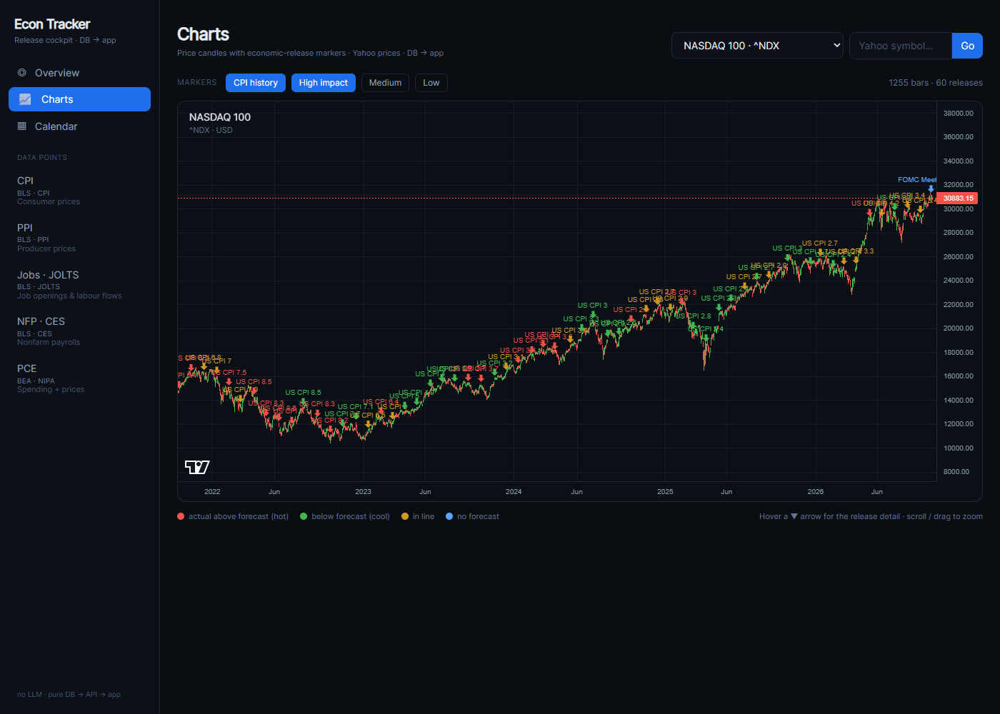
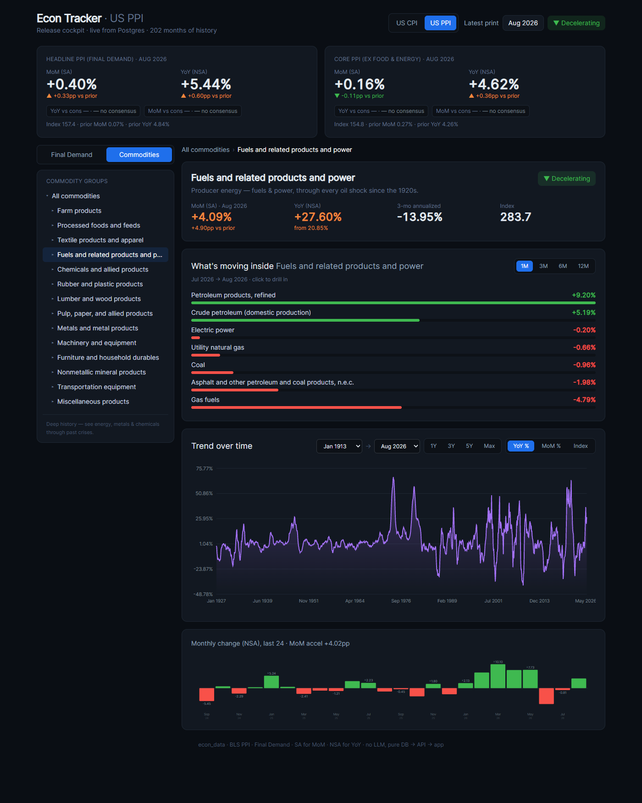
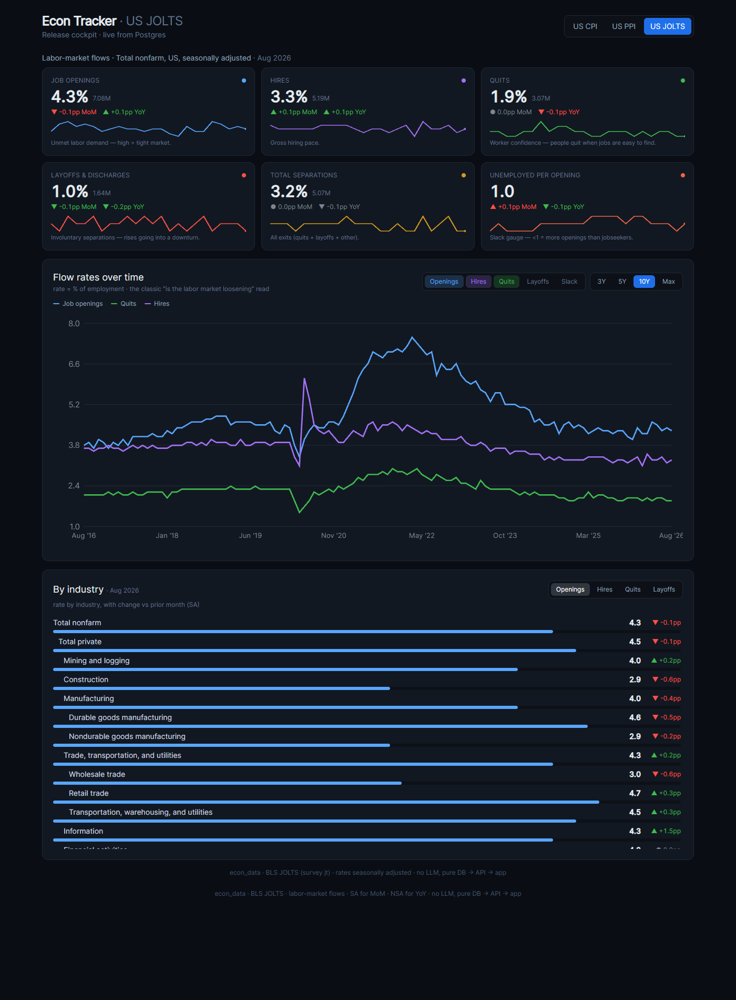
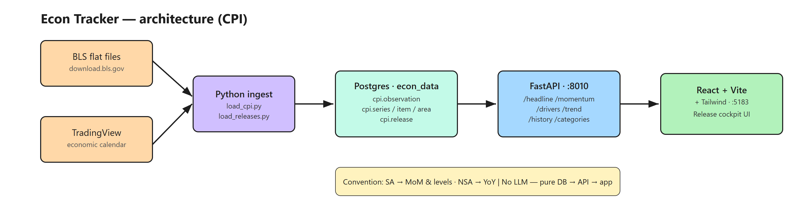

# Econ Tracker

**A self-hosted economic-data cockpit.** It turns raw U.S. Bureau of Labor Statistics releases into fast, interactive dashboards for **CPI, PPI, JOLTS, CES and PCE** — the macro picture a markets person actually cares about, in one place, with momentum and decades of history a click away.

> Pure **DB → API → app**. No LLM, no black boxes. Just clean data and fast charts.



---

## Why I built it

I trade and I follow the markets, and I wanted to read the macro the way it actually moves price: inflation, the labour market, producer prices and consumer spending, side by side, with the momentum and the long history visible at a glance. Off-the-shelf tools either hide the data or charge for it, so I built my own: a pipeline that ingests the official BLS flat files into Postgres, an API that serves them read-only, and a dashboard that makes them fast to explore.

It is also a deliberate engineering exercise — millions of observations, a survey-aware backend, and native per-dataset front-end views — kept clean and reproducible.

## What it does

- **CPI cockpit** — headline & core, 24-month momentum, category breakdown over 1M / 3M / 6M / 12M windows, trend chart, release history, and consensus vs. surprise on releases.
- **PPI explorer** — a native "producer price pipeline" view: the Final Demand tree with drill-down, plus a **commodity lens that reaches back to 1913** (oil shocks, 2008, COVID all visible).
- **JOLTS / CES / PCE explorers** — dataset-specific layouts for job openings & turnover, employment, and personal consumption.
- **Survey switcher** across the top, correct SA / NSA handling per series, and deep historical range selection.

### A few views

| Producer prices (PPI) | Labour market (JOLTS) |
| --- | --- |
|  |  |

## Architecture

```
U.S. BLS / BEA flat files
        │  (Python ingest pipeline)
        ▼
  PostgreSQL  (econ_data)
        │
        ▼
  FastAPI backend  :8010   read-only /api/* (survey-aware)
        │
        ▼
  React + Vite + Tailwind  :5183
        │
        ▼
      browser
```



- **`backend/`** — FastAPI. Read-only `/api/*` endpoints that query Postgres and return JSON. One endpoint family per survey (`/api/headline`, `/api/momentum`, `/api/trend`, `/api/node`, plus dedicated `/api/jolts/*`, `/api/ces/*`, `/api/pce/*`), most taking a `?survey=` (and some a `?cls=`) parameter so a single codebase serves every dataset. DB credentials come from a git-ignored `.env`.
- **`frontend/`** — React + Vite + Tailwind single-page app. `App.jsx` is the shell and the shared CPI-style cockpit; `PPIExplorer.jsx`, `JoltsExplorer.jsx`, `CesExplorer.jsx` and `PceExplorer.jsx` render native per-dataset layouts; `LineChart.jsx` is a dependency-free SVG chart.

## Tech stack

**Python · FastAPI · PostgreSQL · React · Vite · Tailwind · SVG charting.** A companion Python ingest pipeline loads the BLS/BEA public flat files into Postgres (idempotent loaders, schema-per-survey).

## Data coverage

| Survey | Source | Range | Scale |
| --- | --- | --- | --- |
| CPI | BLS | 1913 → present | ~424k observations |
| PPI | BLS | 1913 → present | ~1.8M observations |
| JOLTS | BLS | job openings, hires, separations | — |
| CES | BLS | employment | — |
| PCE | BEA | personal consumption | — |

## Running it locally

Postgres must be running with the `econ_data` database loaded by the ingest pipeline.

```bash
# backend
cd backend
cp .env.example .env          # add your Postgres connection details
python -m uvicorn main:app --port 8010

# frontend (second terminal)
cd frontend
npm install                   # first run only
npm run dev                   # http://localhost:5183
```

## Data sources

U.S. Bureau of Labor Statistics (CPI, PPI, JOLTS, CES) and U.S. Bureau of Economic Analysis (PCE) — official public-domain releases.

## Notes

The API is strictly read-only. All credentials live in a git-ignored `.env` (see `backend/.env.example`); nothing sensitive is committed.
